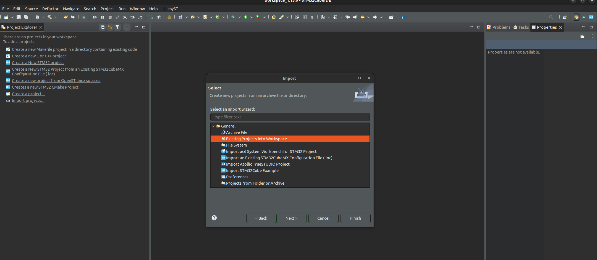
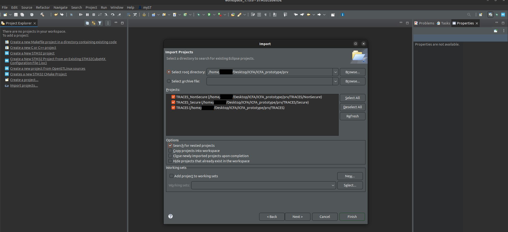
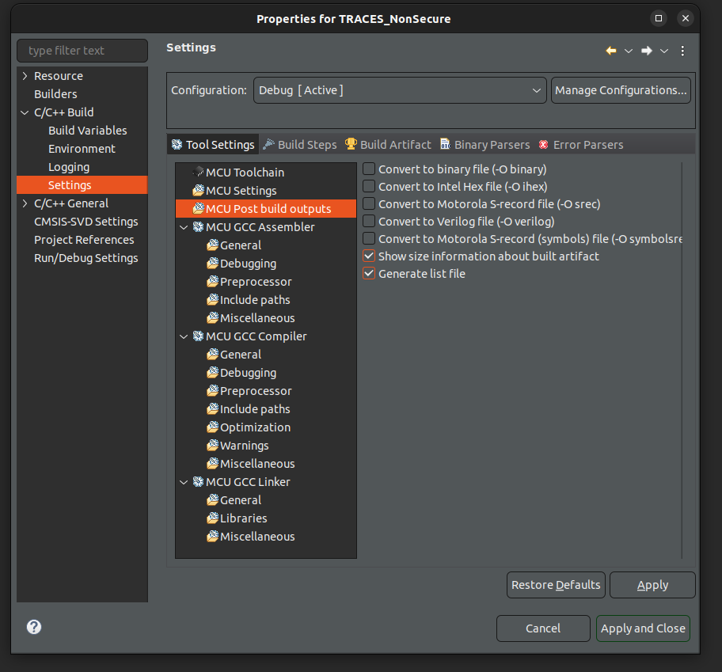
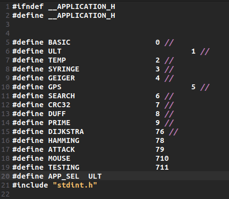
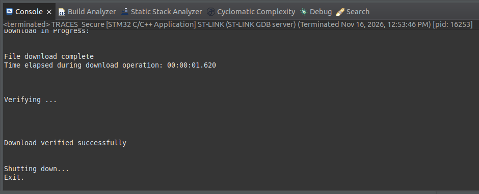
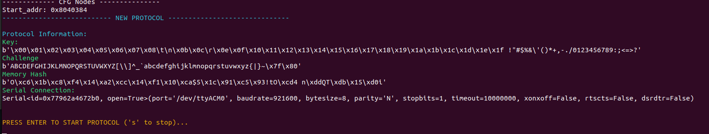
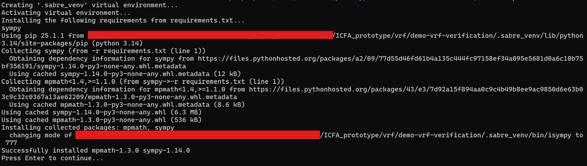
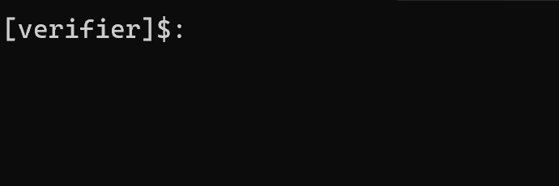
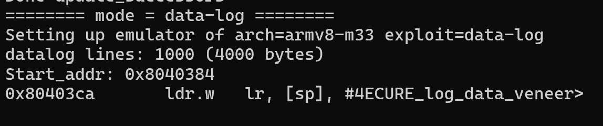
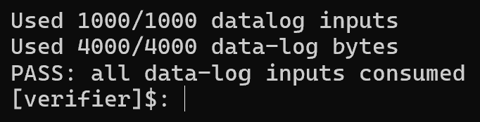

# ICFA

Control Flow Attestation (CFA) logs program control flow transfers (branch destinations) to detect control flow attacks in remote systems. However, log storage and transmission overheads can be prohibitive for microcontrollers. In this work, we show that logs of transfers are not strictly necessary to reconstruct program control flow paths. We present ICFA, an Input-based CFA framework for ARM TrustZone-M microcontrollers. ICFA demonstrates that control flow transfer logs can be fully derived from smaller logs of selected program inputs. Our evaluation of ICFA on various benchmark applications shows that this approach delivers significant performance improvements for most attested applications.

A Map of ICFA's directory structure can be found [here](#respec-directory-structure)

## ICFA Hardware/Dependencies

ICFA's prototype was developed and tested on an Ubuntu 22.04.1 device with a 1.6-6.6 GHz AMD Ryzen 7 8845HS CPU. 

We implement ICFA's prototype using the STM32CubeIDE and deploy our prototype on a NUCLEO-L552ZE-Q development board featuring an STM32L552ZE MCU with support for ARM TrustZone-M. This MCU operates at 110 MHz and uses a UART-to-USB interface with a baud rate of 38400 for communication. 

**Note:** We used STM32CubeIDE 1.15.0 for our development. While other versions of the IDE should work, we've experienced communication issues with the development board when using other CubeIDE versions. Due to this, we recommend using version 1.15.0 when running this prototype.

Using ICFA's prototype relies on several bash and python scripts. The bash scripts require the `gcc-arm-none-eabi` toolchain to be installed. This can be done using:

    apt-get install gcc-arm-none-eabi

Or by downloading it directly from [ARM](https://developer.arm.com/downloads/-/gnu-rm). The Python scripts depend on Python's `ecdsa` package. To install this package run:

    pip install ecdsa

With the dependencies installed, you can begin setting up your project.

## Importing ICFA's STM32 Project

To begin using ICFA, you will need to import the project to the CubeIDE. For this:

0. Clone this repository (if you haven't already)
1. On the left side of the screen is a window labeled "Project Explorer". In this window click "import projects...". If the option is not present you can also click "File -> Import" at the top of the screen. In the resulting dialog box ensure "Existing Projects into Workspace" is highlighted and click "Next >"

2. In the next window, enter the `ICFA_prototype/prv` directory. Once entered three entries should appear in the "Projects:" window. As ICFA's prototype was built atop the TRACES implementation, these entries will be labeled as TRACES. Ensure all three lines are selected and then click "Finish".

3. Once loaded a "TRACES" folder will appear in the Project Explorer window. Again this is just left over naming conventions from the open source implementation ICFA extends. Expanding this folder should reveal two subfolders: "TRACES_NonSecure" and "TRACES_Secure". Right-click TRACES_NonSecure and select "Properties".
4. In the resulting window, select "C/C++ Build -> Settings" in the left column. In this tab select "MCU Post build outputs" and ensure that "Generate list file" is checked. Once enabled click "Apply and Close"

5. Repeat steps 3 and 4 for TRACES_Secure

## Selecting a Test Application

We evaluate ICFA against 6 real-world MCU applications: a Geiger counter (Geiger), GPS sensor (GPS), mouse (Mouse), syringe pump (Syringe), temperature sensor (Temp.), and an ultrasonic sensor (Ultra.). We also test ICFA with the CRC32 check (CRC32), Dijkstra's algorithm (Dijkstra), Duff's device (Duff), Hamming distance (Hamming), and Primality (Prime) programs from the [BEEBS](https://github.com/mageec/beebs) embedded platform.  

To select an application for testing open `ICFA_prototype/vrf/demo-vrf-instr-comm/application.h` and the edit `#define APP_SEL` statement on line 20 with the desired application. The appropriate value for each application is listed above the defines statement.

Once selected, navigate to the `ICFA_prototype/vrf/demo-vrf-instr-comm` directory (if not already there) and run the `pre-process.sh` exactly as follows:

    ./pre-process.sh application instrument

This will configure the application with the necessary ICFA instrumentation and update the `ICFA_prototype/prv` directory. The script may throw some warnings but this is fine.

Once compiled, in STM32CubeIDE right click both TRACES_NonSecure and TRACES_Secure and select "Clean Project". In subsequent runs, cleaning the project may not be necessary, however, we have occasionally build issue if we do not clean the projects prior to the initial build on a new system.

Finally, right click TRACES_NonSecure and TRACES_Secure in Project_Explorer and click "Build Project"

## Running the Application

Once built, you are ready to run the test application. To do this:

0. Ensure the development board is plugged into your device
1. Right click TRACES_Secure in Project Explorer and select "Run as -> STM32 C/C++ application". This will compile the application and flash it onto the MCU. This process takes a minute or two to complete.

2. Once the console window on the bottom of the CubeIDE says "Exit" and stops updating the Prv is ready. Open a terminal and navigate to the `ICFA_prototype/vrf/demo-vrf-instr-comm` directory.

3. Then simply run the provided `vrf_communication_module.py` script. Once launched simply press enter. This will send an attestation request to the Prv and start the attested execution. The module will also save all received CFLogs in the `ICFA_prototype/vrf/cflogs` directory. 

## Verifying CFLog 

The ICFA verifier runs within `vrf/demo-vrf-verification` subdirectory. Steps to run the verifier are listed below.

1. `cd` into the `demo-vrf-verification` directory. Inspect `run.sh` and set the key path variables: `PRV_PATH` and `CFLOG_PATH`. If you maintain this repositories directory structure, these won't need to change. `PRV_PATH` should point to the root directory of the `prv` STM project, while `CFLOG_PATH` should point to the root folder of the ICFA cflogs. 

2. Setup the environment by running `. setup.sh` this will begin creating the `sabre_venv` python virtual environment and install `sympy`. After it has completed, you should see a `Press Enter to Continue` prompt. Press Enter to continue

After that, you will see the empty verifier terminal as shown below

3. Start running the verification using the `run.sh <app>` script (after you have modified `PRV_PATH` and `CFLOG_PATH` as needed during step 1). This script expects one argument <app> which is the name of the application that produced the cflog located in `CFLOG_PATH` and whose application has been compiled and built in `PRV_PATH`. For example, assuming the ultrasonic sensor applcation was built and its cflogs are located in the `ultra` subdirectory of `CFLOG_PATH` (as is with this repository), the folling will occur after pressing enter:

The last line updates in place as instructions are processed by the verifier, using the ICFA cflog. This process will run for some time, as each instruction is evaluated, updates its internal dictionary representations, and updates internal log files.

4. After all inputs are fetched during the emulation and branches are validated, eventually the output below will be produced, showing that the verification passed and that all data from ICFA's cflog was used. 

5. Repeat steps 3-4 for any application, as long as the cflog in `CFLOG_PATH` corresponds to the `.list` and `.elf` files reachable via `PRV_PATH`. To exit the verifier, simply type `deactivate` and press enter. 

## ICFA_prototype/vrf/cflogs Directory

All test CFLogs from our evaluation of ICFA are provided in the `ICFA_prototype/vrf/cflogs/Evaluation_Data` directory. This directory is further subdivided into three sub-directories representing the different architectures tested: baseline, ICFA, TRACES. Each sub-directory contains a folder for applications tested with the following files:

* X.cflog - A numbered cflog generated by the architecture under test. In cases with more than 1 cflog slice, the number indicates the order in which the logs were generated.
* cleaned_times.txt - A file containing the total runtimes achieved from repeat attestation attempts. These times were used to determine the average attestation time for the system
* raw_timing - The raw unproccessed output from the repeated attestation attempts used to generate cleaned_times.txt

**Note:** The baseline directory timing value correspond to the application without any CFA control, not the runtime of the unoptimized CFA architecture used to generate the baseline logs

Finally, the `ICFA_prototype/vrf/cflogs` directory contains 3 helpful scripts for further experimentation. 

The `clean_times.py` script extracts total attestation times from a `raw_timings` file in the same directory and generates the `cleaned_times.txt` file for the experiment.

The `process.py` script describes the basic statistical values of the `cleaned_times.txt` file specified in the script. 

The `baseline_logger.py` script expands optimized loop counters within TRACES cflogs to restore the complete cflog. To use the script, simply run it in the directory of the logs you would like to expand.

### ICFA Directory Structure

	├── ICFA_prototype
	│   ├── prv
    │   │   ├── Drivers
    │   │   │   ├── CMSIS
    │   │   │   │   ├── Device
    │   │   │   │   │   └── ST
    │   │   │   │   │       └── STM32L5xx
    │   │   │   │   │           └── Include
    │   │   │   │   └── Include
    │   │   │   └── STM32L5xx_HAL_Driver
    │   │   │       ├── Inc
    │   │   │       │   └── Legacy
    │   │   │       └── Src
    │   │   ├── NonSecure
    │   │   │   ├── Core
    │   │   │   │   ├── Inc
    │   │   │   │   ├── Src
    │   │   │   │   └── Startup
    │   │   │   ├── Debug
    │   │   │   │   ├── Core
    │   │   │   │   │   ├── Src
    │   │   │   │   │   └── Startup
    │   │   │   │   └── Drivers
    │   │   │   │       └── STM32L5xx_HAL_Driver
    │   │   │   └── Drivers
    │   │   │       └── STM32L5xx_HAL_Driver
    │   │   ├── Secure
    │   │   │   ├── Core
    │   │   │   │   ├── Inc
    │   │   │   │   ├── Src
    │   │   │   │   └── Startup
    │   │   │   ├── Debug
    │   │   │   │   ├── Core
    │   │   │   │   │   ├── Src
    │   │   │   │   │   └── Startup
    │   │   │   │   └── Drivers
    │   │   │   │       └── STM32L5xx_HAL_Driver
    │   │   │   └── Drivers
    │   │   │       └── STM32L5xx_HAL_Driver
    │   │   └── Secure_nsclib
	│   └── vrf
	│       ├── cflogs
    │       │   └── Evaluation_Data
    │       │       ├── baseline
    |       |       |   ├── crc32
    |       |       |   ├── dijkstra
    |       |       |   ├── duff
    |       |       |   ├── geiger
    |       |       |   ├── gps
    |       |       |   ├── hamming
    |       |       |   ├── mouse
    |       |       |   ├── prime
    |       |       |   ├── search
    |       |       |   ├── syringe
    |       |       |   ├── temp
    |       |       |   └── ultra    
    │       │       ├── ICFA
    |       |       |   ├── crc32
    |       |       |   ├── dijkstra
    |       |       |   ├── duff
    |       |       |   ├── geiger
    |       |       |   ├── gps
    |       |       |   ├── hamming
    |       |       |   ├── mouse
    |       |       |   ├── prime
    |       |       |   ├── search
    |       |       |   ├── syringe
    |       |       |   ├── temp
    |       |       |   └── ultra
    │       │       └── TRACES
    |       |           ├── crc32
    |       |           ├── dijkstra
    |       |           ├── duff
    |       |           ├── geiger
    |       |           ├── gps
    |       |           ├── hamming
    |       |           ├── mouse
    |       |           ├── prime
    |       |           ├── search
    |       |           ├── syringe
    |       |           ├── temp
    |       |           └── ultra
    │       └── demo-vrf-instr-comm
    |       |   ├── logs
    |       |   ├── objects
    |       |   └── __pycache__    
            └── demo-vrf-verification
    |           ├── logs
    |           ├── objects
    |           └── __pycache__       
	└── imgs
